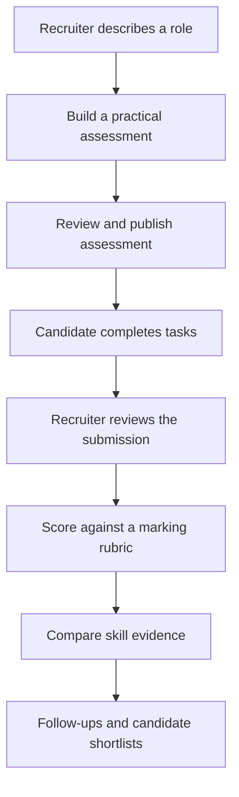

# SkillGraph

### Don't just tell employers what you know. Show them what you can do.

[](https://github.com/akicha22/skillgraph/stargazers)
[](https://github.com/akicha22/skillgraph/network)


---

## What is SkillGraph?

A resume tells a recruiter what someone claims to know. An interview tells them how well that person can explain it.

But where does the actual work fit in?

**SkillGraph is a proof-of-work hiring platform** that gives candidates a way to demonstrate their skills through practical, role-specific assessments.

Recruiters create assessments based on real job requirements. Candidates complete the tasks. Recruiters evaluate the submissions against a structured marking rubric and get a clearer picture of what each candidate can actually do.

The idea is simple: **less guessing, more evidence.**

## Why I built it

I kept coming back to one question:

*What if getting hired wasn't just about having the right keywords on your resume, but actually being able to do the work?*

Someone might write "Excel", "communication" or "problem-solving" on their resume. That doesn't necessarily tell us how they handle messy data, explain a delay to a client, or make a decision when things don't go as planned.

I wanted to build something that brings those skills into the open.

SkillGraph is my attempt at making that happen. It's still evolving, but the direction is clear: make demonstrated ability a bigger part of hiring.

## How it works



## What can you do with it?

### For candidates

- **Build a skill profile** — add your experience, skills, location and a short introduction.
- **Find opportunities** — browse open roles and filter them by location, skills and work type.
- **Take practical assessments** — complete tasks based on the requirements of a particular role.
- **Save work as you go** — your assessment responses are saved before you submit.
- **Understand your results** — see your marks and the criteria used to evaluate your work once it has been reviewed.
- **Practise every day** — get ten short, skill-matched practice drills with increasing difficulty.
- **Track progress** — earn points from checkable practice questions, build a streak and take part in the leaderboard.
- **Answer interview follow-ups** — respond to questions a recruiter raises after reviewing your submission.

Your daily practice is separate from hiring assessments. Recruiters cannot see your private practice answers or use them to score your hiring assessment.

### For recruiters

- **Create assessments from role requirements** — start with a job brief, select relevant skills and define the level and difficulty.
- **Generate and edit assessment drafts** — use the built-in template generator or optionally connect Gemini for help with wording.
- **Publish versioned assessments** — keep published versions separate from drafts and changes.
- **Use structured marking rubrics** — evaluate individual criteria instead of relying on one vague overall score.
- **Review actual submissions** — inspect candidates' answers, task-level evidence and assessment activity.
- **Compare candidates** — compare their evidence across skills and adjust the importance of each skill with saved weights.
- **Identify missing evidence** — see how much of each skill has actually been marked.
- **Ask follow-up questions** — use weak or unmarked criteria to identify what needs clarification.
- **Manage shortlists** — organise candidates into lists and attach private notes.
- **Publish role requirements** — create, edit, close and reopen opportunity posts independently of assessments.

## What makes SkillGraph different?

A few decisions matter more to me than adding another flashy feature.

**1. A skill claim is not the same as skill evidence.**

The platform is built around practical tasks. Instead of relying only on a candidate's self-reported skills, recruiters can inspect work that demonstrates those skills.

**2. AI doesn't decide who gets hired.**

AI can help generate assessment wording, but it does not assign marks or decide a candidate's score. The assessment structure, task data, marks, rubrics and answer keys are controlled by the application. A recruiter evaluates and scores the actual submission.

**3. Missing marks aren't treated as zero.**

An unanswered marking criterion is still pending review. The system doesn't quietly turn missing evaluation into a failed score. Candidate comparisons can show when there isn't enough marked evidence to calculate a meaningful result.

**4. Practice is for the candidate, not the recruiter.**

Daily practice is its own learning loop. It helps candidates improve without becoming another hidden hiring score.

**5. Recruiter notes and answer keys stay private.**

The server controls which information each role can access. Candidates do not receive private answer keys or recruiter-only marking guidance.

## A quick demo

The repository includes seeded demo data so you can explore both sides without having to create everything yourself.

The demo walkthrough takes you through:

1. Creating and publishing an assessment from a role brief.
2. Opening the assessment as a candidate.
3. Submitting an attempt.
4. Marking the submission against its rubric.
5. Comparing candidates using skill weights.
6. Adding candidates to a shortlist with private notes.
7. Exploring daily practice, profiles and opportunities.

**[Open the full demo walkthrough](DEMO.md)**

## Tech stack

I chose a stack that lets the frontend and backend stay separate, while keeping local development straightforward.

| Part | Technology |
|---|---|
| Frontend | React 19, TypeScript |
| Build tool | Vite 8 |
| Styling | Tailwind CSS 4 |
| Routing | React Router 7 |
| Backend | Node.js, Express 5 |
| Database | SQLite |
| ORM and migrations | Prisma 6 |
| Authentication | JWT, httpOnly cookies, bcryptjs |
| Validation | Zod |
| Charts | Recharts |
| Icons | Lucide React |
| Optional AI | Google Gemini API |

The project uses npm workspaces, so the client and server can be managed from the repository root.

## Run it locally

You don't need a paid database, an AI API key or a complicated setup to try SkillGraph.

### Prerequisites

- [Node.js](https://nodejs.org/) **22.12 or newer**
- npm (included with Node.js)
- Git

### 1. Clone the repository

```bash
git clone https://github.com/akicha22/skillgraph.git
cd skillgraph
```

### 2. Install dependencies

Run this from the repository root:

```bash
npm ci
```

### 3. Set up environment variables

Create your local server environment file.

**Windows PowerShell:**

```powershell
Copy-Item server/.env.example server/.env
```

**macOS / Linux:**

```bash
cp server/.env.example server/.env
```

Open `server/.env` and check the values:

```env
DATABASE_URL="file:./dev.db"
PORT=4000
CORS_ORIGIN=http://localhost:5173
JWT_SECRET=replace-this-with-a-random-secret-of-at-least-16-characters
AI_PROVIDER=template
GEMINI_API_KEY=
GEMINI_MODEL=
```

For a normal local setup:

- Keep `DATABASE_URL` as shown. The SQLite database will be created under `server/prisma/`.
- Replace `JWT_SECRET` with your own random value of at least 16 characters.
- Keep `AI_PROVIDER=template`. You do not need an AI key to use the application.

Don't commit your actual `.env` file or share your JWT secret.

### 4. Apply database migrations

From the repository root:

```bash
npm exec -w server -- prisma migrate deploy
```

This creates the local SQLite database and applies the migrations included in the project.

### 5. Add demo data

```bash
npm run db:seed -w server
```

This creates the demo accounts, skill library, sample assessment, candidate submissions, role posts and shortlist.

The seed is safe to run again: existing demo assessment data is not duplicated.

### 6. Start the application

```bash
npm run dev
```

That's it.

| Service | Address |
|---|---|
| Frontend | http://localhost:5173 |
| Backend API | http://localhost:4000 |
| API health check | http://localhost:4000/api/health |

Open the frontend in your browser. The development login page includes a demo-account option.

## Demo accounts

After running the seed command, use these credentials:

| Role | Email |
|---|---|
| Recruiter | `recruiter@skillgraph.test` |
| Candidate 1 | `candidate1@skillgraph.test` |
| Candidate 2 | `candidate2@skillgraph.test` |
| Candidate 3 | `candidate3@skillgraph.test` |

**Password for all four accounts:**

```text
Demo@12345
```

Try the recruiter account first to see the published assessment and submissions. Then sign in as a candidate to experience the other side.

These are public demo credentials. Use them only with an isolated demo database, never with real user data.

For a deployed demo build, the frontend can also display the demo-login option when built with:

```env
VITE_ENABLE_DEMO_LOGIN=true
```

This is a frontend build-time setting. The database still needs to contain the demo accounts.

## Optional: Enable Gemini

Template-based assessment generation is enabled by default. It works without an external API.

To use Gemini for assessment wording, get an API key from [Google AI Studio](https://aistudio.google.com/app/apikey), then update `server/.env`:

```env
AI_PROVIDER=gemini
GEMINI_API_KEY=your_gemini_api_key
```

You can optionally set `GEMINI_MODEL` to override the default model.

A useful distinction: Gemini helps with the wording of an assessment draft. The application remains responsible for its structure, task data, marks, rubrics and answer keys. Recruiters remain responsible for evaluating submissions.

If the provider is unavailable or returns output that fails validation, the application falls back to template generation rather than leaving the recruiter without a draft.

## A few important design decisions

These are intentional parts of the implementation, not just UI choices.

### Human-controlled evaluation

A candidate's score comes from the recruiter's rubric marks. The application calculates totals and skill evidence from those marks; it does not invent them.

### Separate public and private assessment data

Assessment tasks have candidate-visible data and recruiter-only data. The server builds candidate responses without private answer keys, expected answers or marking guidance.

### Role-based access

Authentication uses JWTs stored in httpOnly session cookies. The API checks the user's role and ownership of recruiter resources on the server, rather than relying on frontend navigation alone.

### Independent practice data

Daily tasks, answers and practice progress are separate from hiring assessments. They are not included in recruiter assessment evidence.

### Honest comparisons

A candidate with no marked criteria should not appear to have scored zero. The comparison flow distinguishes missing evidence from an actual score.

## Project structure

```text
skillgraph/
│
├── client/
│   └── src/
│       ├── components/     # Reusable UI and assessment components
│       ├── hooks/          # Authentication and skill hooks
│       ├── layouts/        # Dashboard layout
│       ├── pages/          # Candidate and recruiter screens
│       ├── services/       # Frontend API calls
│       └── types/          # Shared frontend types
│
├── server/
│   ├── prisma/
│   │   ├── migrations/     # Database migrations
│   │   ├── schema.prisma   # Database schema
│   │   ├── seed.ts         # Main seed entry point
│   │   └── seedDemo.ts     # Demo assessment and role data
│   │
│   └── src/
│       ├── ai/             # AI provider and draft generation
│       ├── assessments/    # Assessment assembly and validation
│       ├── auth/           # Authentication logic
│       ├── middleware/     # Authentication and security middleware
│       ├── routes/         # API routes
│       ├── tasks/          # Daily practice and scoring
│       ├── tests/          # Backend tests
│       └── utils/          # Shared server utilities
│
├── DEMO.md                 # Step-by-step demo walkthrough
├── CLAUDE.md               # Project conventions and development rules
├── package.json
└── package-lock.json
```

## Useful development commands

Run these from the repository root.

| Command | What it does |
|---|---|
| `npm run dev` | Starts the frontend and backend together |
| `npm run db:seed -w server` | Seeds the local database |
| `npm exec -w server -- prisma migrate deploy` | Applies existing migrations |
| `npm run db:migrate -w server` | Runs Prisma's development migration command |
| `npm run build -w client` | Type-checks and builds the frontend |
| `npm run lint -w client` | Runs frontend linting |
| `npx tsc --noEmit -p server` | Type-checks the backend |

### Running tests

The backend tests use Node's built-in test runner through `tsx`.

Run individual test files:

```bash
npx tsx --test server/src/ai/ai.test.ts
npx tsx --test server/src/tests/permissions.test.ts
npx tsx --test server/src/tests/dailyTasks.test.ts
```

The permission tests exercise real HTTP requests against a temporary database. The daily-task tests cover practice progression, grading and points.

There isn't a single root-level `npm test` command configured at the moment.

## Things I'd like to improve next

SkillGraph is still evolving. Some directions I want to explore:

- More realistic job scenarios and a broader skill library.
- Better ways to show how a candidate's skills develop over time.
- More assessment formats for different types of work.
- Stronger recruiter insights without turning the process into an automated black box.
- A smoother experience for candidates completing longer assessments.

I'd rather make the core evaluation process genuinely useful than add features just to make the feature list longer.

## Contributing

Found a bug, have an idea, or want to improve something?

- Open an issue and explain what you encountered.
- Include steps to reproduce bugs wherever possible.
- Keep pull requests focused and explain what changed.
- Please don't introduce fake scores, misleading AI claims or candidate-visible private assessment data.

Ideas and constructive feedback are welcome.

---

## One last thing

SkillGraph is built around a pretty simple belief:

**A person's ability shouldn't be limited by how impressive their resume looks. Give them a chance to show the work.**

If you find the idea interesting, a ⭐ on the repository is always appreciated.

[Back to the repository](https://github.com/akicha22/skillgraph)
